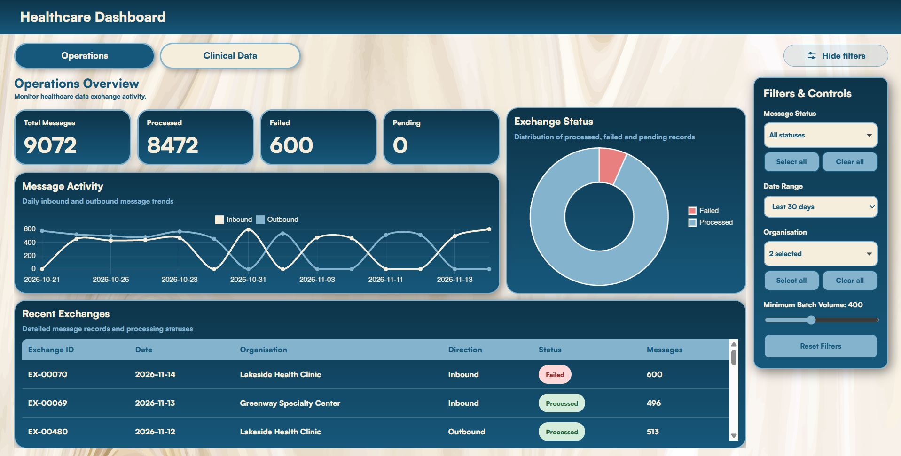
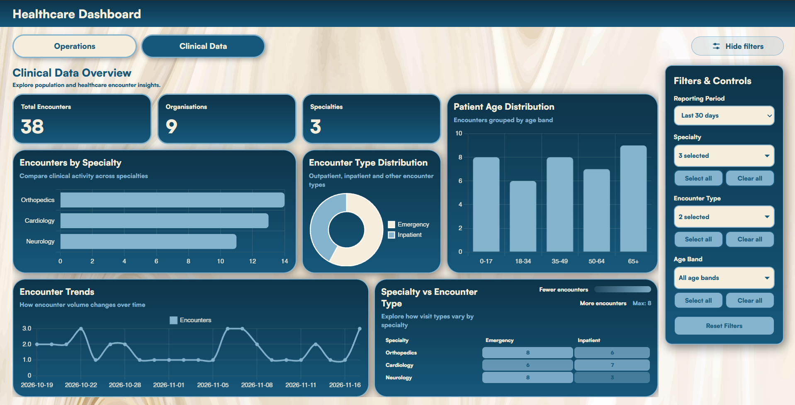

# Healthcare Analytics Dashboard

An interactive **Angular 21 + FastAPI + PostgreSQL** dashboard built as a learning/portfolio project. It visualises **synthetic** healthcare integration activity and clinical encounter summaries through filterable KPIs, charts, and an exchange-record table.

> **Disclaimer:** This is an educational demonstration using synthetic records, not an official healthcare provider or insurer product. It is not for patient care or clinical decisions. No real patient data is included.





## What it does

**Operations tab:** monitors message volume, processed/failed/pending counts, inbound/outbound trends, status distribution and the 20 most recent matching exchange batches. Filters include status and organisation **multi-select**, a relative date range and minimum batch volume. The table scrolls within a fixed-height panel.

**Clinical Data tab:** explores encounter counts, organisation/specialty totals, encounter trends, age distribution, encounter types, specialties and a specialty × encounter-type heatmap. Filters include specialty, encounter type and age band **multi-select**, plus reporting period.

All the cards and visualisations in a tab are calculated from the **same active filters**. Selecting *All* omits a filter; selecting *None* intentionally returns no matching records.

## Technology

- Angular 21, standalone components, Signals, HttpClient, RxJS `forkJoin`
- Angular Material multi-select controls and Chart.js
- Python FastAPI + Psycopg 3
- PostgreSQL
- Custom CSS Grid layouts

## Data flow

```text
Angular filter controls
  → Angular signals → HealthcareData service (HttpClient)
  → FastAPI GET endpoints → parameterised PostgreSQL queries
  → JSON response → Angular signals → KPIs, charts and recent exchanges
```

## Repository layout

```text
healthcare-dashboard/
├── frontend/                      # Your full Angular project goes here
│   ├── src/
│   │   ├── app/
│   │   │   ├── app.ts
│   │   │   ├── app.html
│   │   │   ├── app.css
│   │   │   ├── services/healthcare-data.ts
│   │   │   ├── metric-cards/       # Copy from your existing project
│   │   │   └── chart-panel/        # Copy from your existing project
│   │   └── styles.css             # Copy from existing project, including Material styles
│   ├── package.json               # Copy from existing project
│   ├── package-lock.json          # Copy from existing project
│   ├── angular.json               # Copy from existing project
│   └── proxy.conf.json            # Copy from existing project
├── backend/
│   ├── main.py
│   ├── schema.sql
│   ├── load_demo_data.py
│   └── requirements.txt
├── data/                         # Synthetic CSV demo fixtures
├── docs/
│   ├── screenshots/
│   ├── ARCHITECTURE.md
│   ├── DATA_DICTIONARY.md
├── .gitignore
└── README.md
```

**Note:** This cleanup download contains your five supplied source files and documentation. It is **not** a complete runnable Angular checkout because the other existing project files were not supplied. Copy those unchanged from your working project.

## Local setup

### Prerequisites

Install Node.js compatible with your Angular 21 project, Python 3.10+ (your existing environment's supported version), and PostgreSQL. Copy your existing Angular project into `frontend/`, including its package files, application configuration, components, assets and proxy configuration.

### Database

Create a local database named `healthcare_db` (for example, in pgAdmin or using `createdb -U postgres healthcare_db`). The package includes three **synthetic** CSVs, `backend/schema.sql` and `backend/load_demo_data.py`. After installing backend dependencies and setting `PGPASSWORD`, run `python load_demo_data.py` from `backend/` **once** to create and populate the tables. Existing IDs are not overwritten; re-running without clearing tables will produce duplicate-key errors. See [the data dictionary](docs/DATA_DICTIONARY.md). Never publish real patient information.

### API

```powershell
cd backend
python -m venv .venv
.\.venv\Scripts\Activate.ps1
pip install -r requirements.txt
$env:PGPASSWORD = "YOUR_LOCAL_POSTGRES_PASSWORD"
python load_demo_data.py  # Once, on a new empty healthcare_db
python -m uvicorn main:app --reload --host 127.0.0.1 --port 8000
```

Run in a separate PowerShell session. The current `main.py` uses `localhost:5432`, PostgreSQL user `postgres` and database `healthcare_db`. Adapt those local connection settings if needed; do not commit passwords.

Explore the API at `http://127.0.0.1:8000/docs`.

### Angular

```powershell
cd frontend
npm ci
npx ng serve --port 4202 --proxy-config proxy.conf.json --open
```

`proxy.conf.json` should forward `/api/**` to `http://127.0.0.1:8000`. Browser requests use relative `/api/` paths so the frontend and backend can run separately during development.

For a production build: `npx ng build`.

## Example requests

```text
GET /api/organisations
GET /api/clinical/options
GET /api/operations/summary?status=failed&status=pending&days=30
GET /api/operations/charts?min_volume=200
GET /api/operations/records?organisation_id=ORG001
GET /api/clinical/summary?specialty=Cardiology&specialty=Neurology
GET /api/clinical/charts?encounter_type=Emergency&age_band=35-49
```

The example organisation ID is illustrative: use IDs actually returned by `/api/organisations`.

## Limitations and next steps

This is a local educational prototype, not a deployed production health system. It currently uses read-only demo data and no authentication, monitoring or deployment pipeline. Rapid changes to filters can lead to overlapping requests; chart empty states and request cancellation can be improved. The source data is fixed rather than a live hospital integration stream.

## Development story

Built to practise moving from Angular fundamentals to a data-driven dashboard: signals, component inputs, reusable charts, services, HTTP requests, RxJS coordination, Python APIs, SQL aggregation and multi-filter UX. The project is **not** affiliated with any healthcare employer or proprietary product.

## License and attribution

Before adding a license, confirm permission for all assets (especially fonts and screenshots). Do not commit redistributable font files unless the license explicitly permits it. Consider an MIT license for code you own after reviewing third-party asset requirements.
